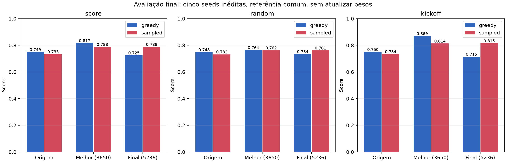

# Resultado final da madrugada

Treino encerrado normalmente às **06h58**, com **5.236 novas iterações** e
**171.573.248 novas amostras**. Nenhum processo de treino permanece ativo.
A automação foi pausada após o horário limite; os modelos principais não foram substituídos.

## Avaliação independente do painel de seleção

Seeds 3701–3705, 8 ambientes, 600 decisões por caso, referência neural comum.
Ambos os lados, kickoff/random, cinco adversários e modos greedy/amostrado.
600 casos completos e únicos foram verificados. Esta avaliação não atualizou pesos.

| Checkpoint | Modo | Balanceado | Random | Kickoff |
|---|---|---:|---:|---:|
| origin | greedy | 0.74919 | 0.74825 | 0.75013 |
| origin | sampled | 0.73303 | 0.73208 | 0.73398 |
| best_it3650 | greedy | 0.81686 | 0.76432 | 0.86939 |
| best_it3650 | sampled | 0.78805 | 0.76233 | 0.81376 |
| final_it5236 | greedy | 0.72477 | 0.73437 | 0.71517 |
| final_it5236 | sampled | 0.78820 | 0.76149 | 0.81491 |

## Leitura do resultado

O maior score interno (0,87147 na iteração 3.650) veio de um painel usado
repetidamente para selecionar checkpoints. A tabela nova é a evidência mais
apropriada para comparar origem, melhor checkpoint e endpoint nas mesmas condições.
O score final interno foi 0,70907; portanto usar somente a última iteração
descartaria o checkpoint intermediário mais forte no painel de seleção.

O aprendizado não foi monotônico: random ficou mais estável, enquanto kickoff
oscilou fortemente. A correção de bootstrap E1 não demonstrou vantagem geral
nas três seeds da ablação; a continuação preservou B0. Não foram implementados
PBRS, crítico separado ou observações enriquecidas nesta etapa.

Seeds de avaliação não são réplicas independentes de treinamento. O teste
novo avalia esses checkpoints de uma única continuação; não certifica robustez
entre seeds de treinamento, transferência para sala real ou desempenho em equipes.
O resultado permite inspecionar um candidato; não garante convergência nem
autoriza promoção automática. Diferenças por adversário/lado estão em
`final_case_comparison.json`; curvas e fundamentos em `REPORT.md` e `CONTINUATION.md`.

## Checkpoints preservados

- Melhor painel interno: `runs/sprint1_overnight_model_20261014/train/model.pt`, iteração 3.650.
- Endpoint: `runs/sprint1_overnight_model_20261014/train/model_final.pt`, iteração 5.236.
- Metadados correspondentes: `meta.json` e `meta_final.json` na mesma pasta.

Pesos são finitos e os metadados finais correspondem ao contador real.

## Interpretação da diferença entre greedy e amostrado

Na avaliação inédita, origem/melhor/final têm scores greedy 0,74919/0,81686/0,72477
e amostrados 0,73303/0,78805/0,78820. A diferença de 0,00015 entre melhores e
finais scores amostrados é descritivamente muito pequena; não demonstra igualdade
estatística. O endpoint perde greedy sem perder o ganho amostrado agregado.

O recorte somente heurístico, onde mudar o modo não muda a política do adversário,
resulta em 0,87368 versus 0,76019 greedy (melhor/final), e 0,79539 versus 0,78939
amostrado. Assim, a diferença não depende apenas de amostrar a referência neural.
PPO otimiza a política estocástica; tomar argmax de cada cabeça produz outra
política. Não há garantia de que a qualidade de uma se preserve na outra. Esse
é um mecanismo compatível com os dados, mas não uma demonstração causal completa
de por que determinados estados de kickoff mudaram. O teste de margens de logits
não estabeleceu uma causa exclusiva; não cabe alterar arquiteturas retrospectivamente.

Há também regressão específica contra a referência neural: em greedy a origem
marca 0,90854, o melhor 0,58959 e o final 0,58310. Os ganhos agregados do melhor
vêm dos quatro adversários heurísticos e não representam domínio uniforme de
todos os adversários. Isso é compatível com especialização/esquecimento ou
relações não transitivas, mas requer investigação adicional para distinguir causas.
Uma média balanceada maior não elimina esse risco de comportamento.

O checkpoint da iteração 3.650 é o candidato preferível dos dois treinados para
o modo greedy no painel especificado; não é uma melhoria universal ou modelo
certificado para sala real. Os testes concluíram o orçamento autorizado; a sprint
ainda exige comparações estruturais controladas e validação de comportamento.

