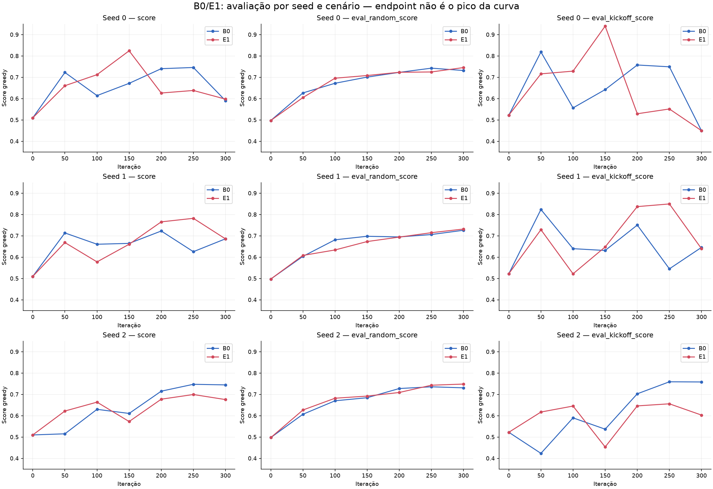
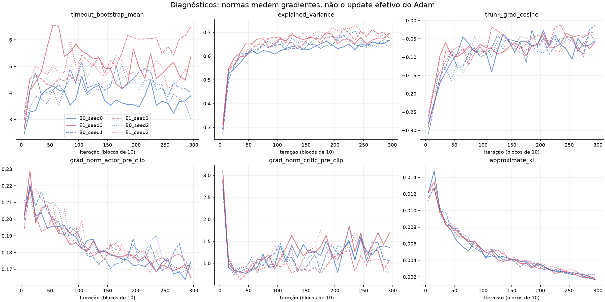
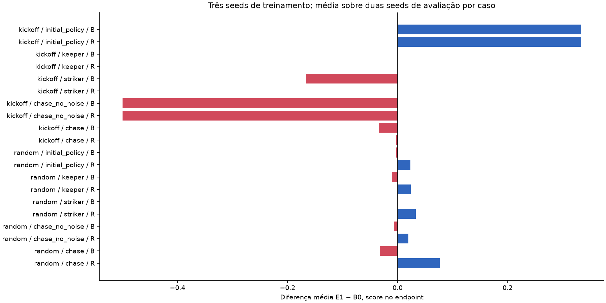
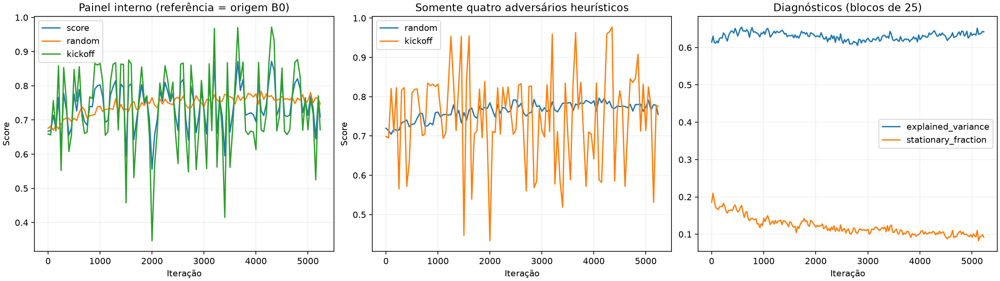
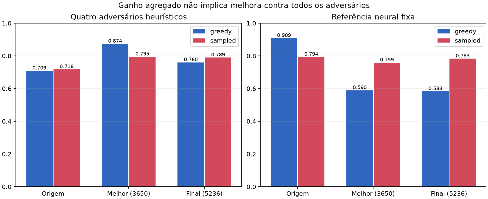

# Revisão da madrugada — 14/10/2026

## Integridade da comparação

Os seis treinos terminaram às 01:58 locais, sem erro registrado: 300 iterações e
9.830.400 amostras por braço/seed, 58.982.400 no total. Hashes da fonte e mapa
congelados foram verificados. O analisador verificou hashes da origem, orçamento,
40 casos de avaliação por endpoint, pesos iniciais iguais e painéis iniciais iguais
em cada par. As métricas escalares verificadas são finitas. Todos os braços tiveram
aproximadamente 27 mil timeouts: a intervenção efetivamente foi exercitada.

A bateria passa com 17 testes, incluindo agora uma comparação de GAE com somas
explícitas para 133 posições de partida aleatórias por modo, em float64, tolerância
1e-12. Isso verifica os dois modos sem depender apenas de exemplos de uma transição.
Os testes existentes cobrem gol, timeout, simultaneidade, final de rollout,
observação antes do reset e preservação dos gradientes do update.

## Resultado e implicações

| Endpoint E1 − B0 | Média das três seeds | Mínimo | Máximo |
|---|---:|---:|---:|
| Score balanceado | −0,02065 | −0,06885 | +0,00716 |
| Random | +0,01238 | +0,00573 | +0,01767 |
| Kickoff | −0,05368 | −0,15537 | +0,00057 |

E1 melhora random nas três seeds, porém o ganho é pequeno. Não se demonstrou uma
melhoria geral: o kickoff piora em duas seeds e cai muito na seed 2. B0 também oscila
fortemente: seed 0 passa de 0,746 na iteração 250 a 0,590 na 300. Portanto regressão
na avaliação não é exclusiva da nova máscara. Exploitabilidade, convergência e
comportamento em sala real não foram medidos por esta comparação.

Os gráficos não suavizam a avaliação; os diagnósticos usam médias em blocos de dez
iterações. Não há barras de confiança tratando ambientes como seeds independentes.

## Fundamentação e limites da inferência

A distinção entre episódio finito e corte artificial de coleta determina a
semântica do bootstrap. Para um corte artificial, o residual usa
`delta = r + gamma * (1-terminated) * V(final) - V(current)` e a recursão GAE corta
em `terminated | truncated`. Para uma partida realmente finita, o timeout pertence
ao objetivo e o tempo restante precisa ser representado. Essa distinção é
estabelecida por [Pardo et al., 2018](https://proceedings.mlr.press/v80/pardo18a.html).

E1 implementa a primeira semântica, mas `V(final)` é uma aproximação aprendida.
Em um timeout sua diferença imediata em relação a B0 é `gamma * V(final)`; essa
alteração se propaga aos resíduos anteriores pelo fator `(gamma*lambda)^k` até a
fronteira anterior. O sinal depende do crítico e da recompensa densa. Os valores
finais positivos observados não provam que o time-limited score de vitória aumentará.
O treino otimiza retorno descontado com shaping; a avaliação conta vitória/empate
no limite de tempo. Esses objetivos não são idênticos.

O adversário de self-play também muda entre rollouts. A aprendizagem do crítico e
ator ocorre contra uma distribuição em evolução; não há argumento aqui de
progresso monotônico. `DefaultObs` não resolve todas as variáveis ocultas do jogo e
não inclui relógio restante. Por isso a correção de uma condição de fronteira não
converte automaticamente este experimento em um MDP plenamente observado.

Os cossenos negativos no tronco indicam oposição entre componentes naquele
minibatch, mas não identificam a causa do kickoff. Normas de gradientes não medem
sozinhas o update Adam. A variância explicada termina aproximadamente entre 0,64 e
0,71; isso é ajuste aos alvos estimados de valor, não uma medida de qualidade do
jogo. KL e clip fractions nos endpoints são pequenos, sem evidência de explosão
numérica. Esses diagnósticos não excluem mudanças importantes de ações greedy:
a argmax pode trocar abruptamente quando logits próximos mudam pouco.

O [PPO de Schulman et al., 2017](https://arxiv.org/abs/1707.06347) fornece o objetivo
surrogate com atualizações em minibatches. Esta implementação não demonstra uma
garantia de melhoria de nosso score greedy. O uso de várias épocas e clipping da
razão não elimina a necessidade de avaliar as políticas resultantes.

Três seeds são poucas para conclusão estatística. A média dos casos dá peso igual
a adversários, lados e cenários, não a episódios. Ambientes de kickoff com políticas
greedy e adversário determinístico podem repetir trajetórias; multiplicá-los não
multiplica a evidência independente. A inspeção por adversário/lado preserva essas
limitações na análise.

## Ação durante a madrugada

Não foi encontrado um defeito demonstrado no GAE ou captura final que justifique
alterar as máscaras até obter um score favorável. Uma regressão é evidência a
investigar, não autorização para escolher retrospectivamente uma hipótese vencedora.

Foi estabelecida, antes da nova avaliação, uma verificação de continuação em cinco
seeds inéditas (2701–2705), dois modos (greedy/amostrado), ambos os lados, dois
cenários e os cinco adversários existentes. Três candidatos: origem, melhor
checkpoint B0 seed 2 e melhor checkpoint E1 seed 0. Escolhe-se um representante por
braço com base no painel antigo; o teste novo tem 8 ambientes e 600 decisões por caso.
Candidatos precisam superar a origem em pelo menos 0,02 em ambos os cenários de
ambos os modos. Entre elegíveis, escolher maior mínimo desses quatro scores,
desempatando pela média. Esse filtro permite uma continuação exploratória; não
prova E1 superior em média, nem é certificação de implantação. Depois de usado para
seleção, esse painel também deixa de ser uma validação final independente.

O limite de 07h possui duas camadas: salvamento normal por prazo no treinador e
supervisor do grupo de processos. Uma execução curta parou com 28 iterações,
salvou modelo/meta final e terminou antes do prazo. Outro teste forçou leader e
filho a ignorarem SIGTERM; o supervisor encerrou ambos por SIGKILL antes do limite.
O experimento original executou fonte congelada, portanto as alterações de parada
e de avaliação não modificaram retroativamente seus seis braços.

O resultado dessa verificação e a decisão de continuar serão registrados abaixo.

## Verificação nova e decisão

| Candidato | Modo | Random | Kickoff | Balanceado |
|---|---|---:|---:|---:|
| source | greedy | 0.51159 | 0.51357 | 0.51258 |
| source | sampled | 0.50523 | 0.51855 | 0.51189 |
| B0_seed2_best | greedy | 0.74413 | 0.74752 | 0.74583 |
| B0_seed2_best | sampled | 0.73716 | 0.76539 | 0.75128 |
| E1_seed0_best | greedy | 0.71831 | 0.94369 | 0.83100 |
| E1_seed0_best | sampled | 0.69506 | 0.70304 | 0.69905 |

Os dois candidatos passam o limiar de ganho em relação à origem. Pelo critério
pré-fixado de maior mínimo entre cenários/modos, foi escolhido **B0 seed 2, iteração
250**, com mínimo 0,73716. E1 seed 0, iteração 150, tem mínimo 0,69506. Seu excelente
kickoff greedy (0,94369) cai para 0,70304 com ações amostradas. Isso não identifica
um defeito na implementação, mas mostra a fragilidade de escolher só o pico greedy.
B0 conserva scores em torno de 0,74–0,77 nas quatro combinações. A seleção entre
esses dois representantes não altera o resultado dos endpoints da ablação.

A continuação foi iniciada às 02:34 locais: `runs/sprint1_overnight_model_20261014`.
Orçamento estimado de **5.779 novas iterações**, 189.366.272 amostras caso todas
caibam no prazo. A duração medida no braço de origem, incluindo suas avaliações,
foi usada para estimar o orçamento; variação no ritmo pode reduzir o número final.
O cutoff absoluto é 07:00, com reserva normal de 120 segundos.

Ator e crítico foram preservados. Adam, pool e schedules recomeçam; não se trata
de retomada exata. Mantidos timeout zero do candidato B0, recompensa 0,15/0,08/25,
DefaultObs16 e 64/6/4. Uma pasta nova guarda fonte/mapa/checkpoint congelados e
metadados. Nenhum modelo principal foi promovido.

A referência `initial_policy` da avaliação interna da continuação é agora o
checkpoint escolhido como origem, mais forte que a referência dos seis braços.
Assim, seus scores balanceados brutos não são diretamente comparáveis aos scores
anteriores; os quatro adversários heurísticos continuam permitindo comparação
por caso. Uma avaliação posterior com referência fixa é necessária para comparar
modelos finais. Mais iterações podem voltar a degradar o kickoff; os checkpoints
periódicos e o melhor checkpoint permanecem disponíveis.

Bloqueios firmes: nenhum neste momento. A automação deve acompanhar progresso real,
intervir em falhas demonstradas, confirmar o cutoff e registrar o resultado final.

## Acompanhamento da continuação

Estado atualizado, curvas e comparação com o início: [CONTINUATION.md](CONTINUATION.md).
Este arquivo é atualizado nas verificações da madrugada, sem alterar o treino ativo.

## Encerramento por horário — 07h

O supervisor registrou saída normal (código 0) às **06:58:14 locais**. O treinador
registrou `stop_reason=deadline`, 5.236 iterações e **171.573.248 novas amostras**.
Os processos de treinamento e supervisor não estavam mais ativos na conferência
das 07h. A reserva de salvamento funcionou; não foi necessário matar o processo.
As 5.779 iterações eram uma estimativa de orçamento; o cutoff prevaleceu sobre ela.

O modelo final e seus metadados foram salvos e conferidos com o contador real.
Pesos dos dois checkpoints são finitos; hashes da fonte congelada foram novamente
verificados. `model.pt` corresponde ao melhor painel interno, **iteração 3.650**,
score 0,87147. `model_final.pt` corresponde à **iteração 5.236**, score 0,70907.
O final supera o início no mesmo painel (0,66739), mas perde para o pico e quase
não melhora kickoff: 0,65902 para 0,67118; random passa de 0,67575 para 0,74696.
Esse resultado rejeita a leitura de que alongar o treino produz melhoria monotônica.
Não demonstra uma falha de execução ou invalida por si só o checkpoint intermediário.

O recorte de adversários heurísticos melhora, no endpoint, de 0,71969 para 0,75517
em random e de 0,69877 para 0,77648 em kickoff. O score total incorpora também
a referência neural de origem, portanto essas agregações diferentes não devem
ser confundidas. Oscilações e seleção entre mais de cem avaliações podem inflar
a impressão causada pelo melhor score. A avaliação final em cinco seeds inéditas
3701–3705 está comparando origem, melhor e endpoint, em modos greedy/amostrado e
com a mesma referência neural fixa. Esse é apenas teste, sem atualizar pesos.

Nenhum treino foi iniciado após 07h; nenhum checkpoint foi promovido aos modelos
principais. A parada e o relatório são a conclusão do orçamento autorizado.

### Inspeção descritiva do ator

Em 2.048 observações de jogador obtidas de 1.024 resets aleatórios (seed 4711),
os melhores e finais atores concordam no argmax em 97,27% dos comandos X, 87,84%
dos comandos Y e 95,61% dos comandos de chute. Portanto há mudanças de decisão
reais entre checkpoints apesar de ambos permanecerem numericamente válidos.
A concordância não mede qualidade e os estados não são uma distribuição de
partidas jogadas. Apenas cerca de 1–3% das observações apresentam margens de logits
menores que 0,1 por cabeça; esse teste não confirma que empates de logits sejam a
causa dominante da oscilação do kickoff. É uma hipótese possível nas trajetórias
relevantes, que exigiria inspeção localizada para ser estabelecida. Valores brutos
e escopo estão em `actor_comparison.json`.

Não se compara diretamente o pico 0,871 do painel de seleção com o score do teste
final: mudam seeds, janela (400 para 600 decisões) e referência neural. Comparações
causais entre candidatos devem usar as mesmas condições da nova avaliação. Janelas
finitas contabilizam somente episódios concluídos; durações diferentes e episódios
interrompidos no fim podem afetar essa agregação. Isso reforça a necessidade de
reportar casos/contagens e não certificar robustez por um único pico.

## Avaliação final consolidada

Resultados em seeds inéditas, gráficos e checkpoints: [FINAL.md](FINAL.md).
A automação está pausada e o orçamento da madrugada foi encerrado.

## Interpretação da diferença entre greedy e amostrado

Na avaliação inédita, origem/melhor/final têm scores greedy 0,74919/0,81686/0,72477
e amostrados 0,73303/0,78805/0,78820. A diferença de 0,00015 entre melhores e
finais scores amostrados é descritivamente muito pequena; não demonstra igualdade
estatística. O endpoint perde greedy sem perder o ganho amostrado agregado.

O recorte somente heurístico, onde mudar o modo não muda a política do adversário,
resulta em 0,87368 versus 0,76019 greedy (melhor/final), e 0,79539 versus 0,78939
amostrado. Assim, a diferença não depende apenas de amostrar a referência neural.
PPO otimiza a política estocástica; tomar argmax de cada cabeça produz outra
política. Não há garantia de que a qualidade de uma se preserve na outra. Esse
é um mecanismo compatível com os dados, mas não uma demonstração causal completa
de por que determinados estados de kickoff mudaram. O teste de margens de logits
não estabeleceu uma causa exclusiva; não cabe alterar arquiteturas retrospectivamente.

Há também regressão específica contra a referência neural: em greedy a origem
marca 0,90854, o melhor 0,58959 e o final 0,58310. Os ganhos agregados do melhor
vêm dos quatro adversários heurísticos e não representam domínio uniforme de
todos os adversários. Isso é compatível com especialização/esquecimento ou
relações não transitivas, mas requer investigação adicional para distinguir causas.
Uma média balanceada maior não elimina esse risco de comportamento.

O checkpoint da iteração 3.650 é o candidato preferível dos dois treinados para
o modo greedy no painel especificado; não é uma melhoria universal ou modelo
certificado para sala real. Os testes concluíram o orçamento autorizado; a sprint
ainda exige comparações estruturais controladas e validação de comportamento.

