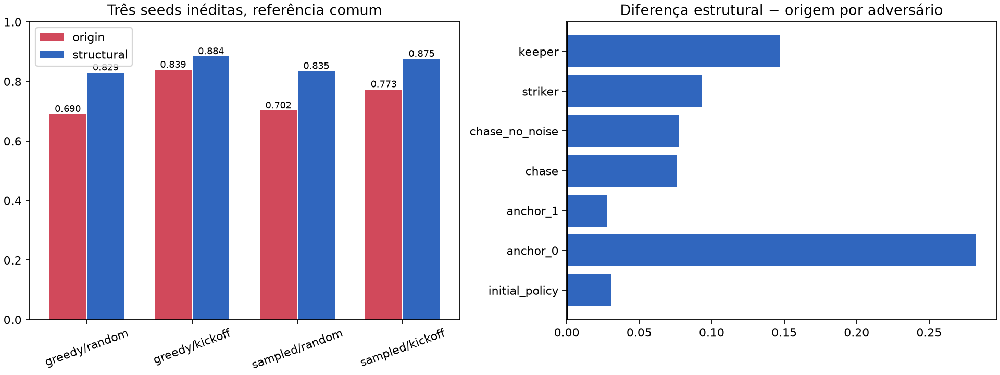

# Validação independente do primeiro candidato estrutural

Checkpoint avaliado: iteração 450 do novo treino.
Seeds 5701–5703, 8 ambientes, 500 decisões por caso, ambos os lados, dois modos,
dois cenários e sete adversários. 336 casos únicos e completos foram verificados.

| Candidato | Modo | Média | Random | Kickoff |
|---|---|---:|---:|---:|
| origin | greedy | 0.76430 | 0.69005 | 0.83855 |
| origin | sampled | 0.73747 | 0.70193 | 0.77302 |
| structural | greedy | 0.85656 | 0.82938 | 0.88375 |
| structural | sampled | 0.85492 | 0.83456 | 0.87528 |

| Adversário | Origem | Estrutural | Diferença |
|---|---:|---:|---:|
| initial_policy | 0.51516 | 0.54552 | +0.03036 |
| anchor_0 | 0.66694 | 0.94933 | +0.28239 |
| anchor_1 | 0.76160 | 0.78975 | +0.02814 |
| chase | 0.82363 | 0.89970 | +0.07607 |
| chase_no_noise | 0.82566 | 0.90268 | +0.07702 |
| striker | 0.84700 | 0.94005 | +0.09305 |
| keeper | 0.81621 | 0.96315 | +0.14694 |

Todos os quatro grupos modo×cenário melhoraram nessa comparação. O mínimo foi
de 0,69005 para 0,82938. É um avanço observado fora das seeds do painel usado
para selecionar o checkpoint, incluindo referências neurais. Não se infere
robustez em diferentes seeds de treinamento: esta é uma continuação, seed 0.
Nem se atribui o ganho isoladamente ao PBRS, à separação ou ao currículo, pois
o preset combina essas intervenções. O teste não certifica sala real/equipes.

O checkpoint exato fica em `models/sprint1_validated/model.pt`, com metadados
e mapa. Ele é distinto de `models/sprint1_latest`, cujo candidato e resume
podem avançar conforme o treino continua. Não foi substituído o modelo original.
