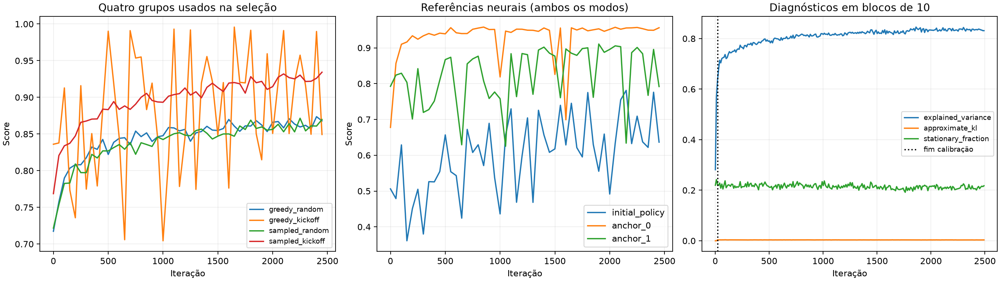
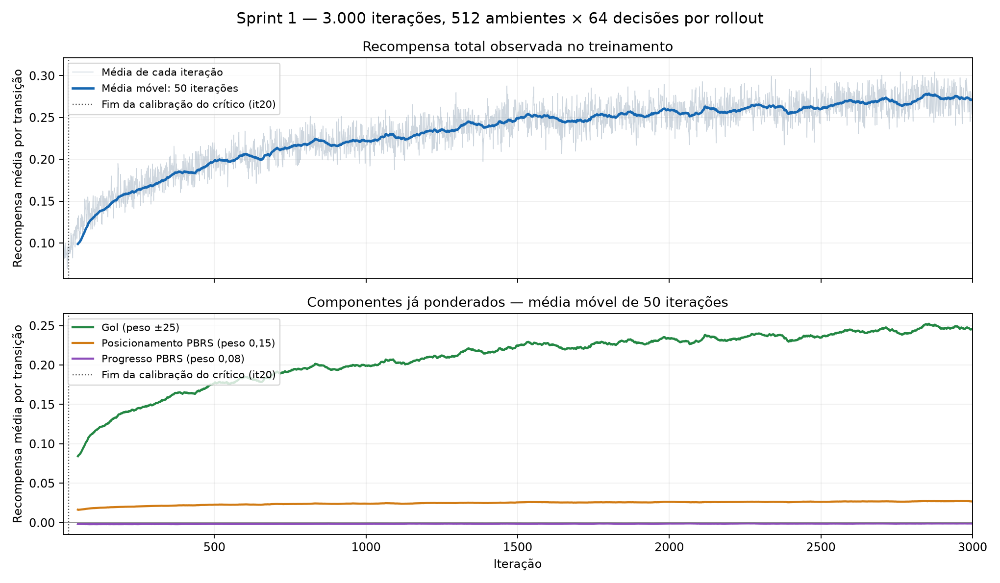

# Sprint 1 estrutural — relatório

Estado: completed; atualização UTC: 2026-10-14T15:54:15.584581+00:00.
Última avaliação: iteração 3000; treino já completou pelo menos 3000 iterações.

**Recompensa PBRS, crítico separado e currículo estacionário estão efetivamente ativos.**
Isso foi conferido em config.json, tipos dos termos de reward e gradientes na telemetria.

## Verificação empírica inicial

| Grupo | Início | Última avaliação |
|---|---:|---:|
| greedy_random | 0.71734 | 0.87440 |
| greedy_kickoff | 0.83606 | 0.91908 |
| sampled_random | 0.72166 | 0.86172 |
| sampled_kickoff | 0.76868 | 0.94480 |
| Mínimo (critério de seleção) | 0.71734 | 0.86172 |

| Adversário neural | Início | Última avaliação |
|---|---:|---:|
| initial_policy | 0.50616 | 0.66206 |
| anchor_0 | 0.67774 | 0.95582 |
| anchor_1 | 0.79257 | 0.91910 |

Valores são observações no painel de seleção, não uma prova estatística de superioridade.
Ainda não se presume estabilidade em vários checkpoints/seeds. A diferença entre modos
e regressão por adversário continuam sendo critérios de investigação. O preset reúne
intervenções; uma melhora eventual não identifica causalmente cada uma.

## Testes e integração

- 31 testes unitários de física, GAE, PBRS, separação de gradientes, migração e save/RNG.
- Smoke com PBRS/separação/currículo e duas referências históricas.
- SIGTERM na iteração 3 e retomada bem-sucedida até 30, preservando Adam/contador.
- Calibração: ator invariável, crítico atualizado e casos de avaliação exatamente iguais.
- Paridade JS/PyTorch: 256 observações dos dois lados, erro máximo de logits 4,6e-6, mesmas ações greedy.
- Rearmamento do chute preservado no teste headless.

A retomada não preserva partidas nativas; leia README.md. O bundle coerente está em
`models/sprint1_latest`, derivado de uma resume.pt completa. Arquivos em `runs/` são
locais e não substituem o backup publicado. Não foi sobrescrito `models/model.pt`.

## Mudanças implementadas

Contratos, fundamento, decisões sobre a geometria e limites estão em README.md.
Não se anuncia PFSP ou observação enriquecida como implementados: são etapa posterior.
A etapa central que antes estava pendente — tabela PBRS, crítico separado e currículo —
foi implementada e está sendo treinada nesta execução.

Validação inédita do candidato: [HELDOUT.md](HELDOUT.md).
Ablação curta controlada: [ABLATION.md](ABLATION.md).
Publicações anteriores: `a6ba071` (implementação), `8d05fc6` (validação independente).
Backup publicado/preparado: it3000 / melhor it2550; verificação em JOURNAL.md.
Decisões, publicações e limitações persistentes: [JOURNAL.md](JOURNAL.md).

## Benchmark final e jogo humano

Concluído e auditado: 3324 casos, 106368 primeiras partidas completas.
[Interpretação, resultados e gráficos](benchmark_3000/ANALYSIS.md).
Best it2550 foi preservado como candidato humano; exportação JS validada.
Sala bloqueada por token/captcha (erro38), sem link de conexão confirmado.
Treino encerrado em3000, publicado em3e44251; mapa portátil corrigido emd391eb0.

Publicação final confirmada na branch gpt: 82bc590 — benchmark auditado,
gráficos de desempenho/self-play/trajectórias e política exportada do candidato
humano. Sala permanece bloqueada pelo token/captcha; nenhuma execução
de treinamento continua ativa.

## Recompensa ao longo das iterações

Média das primeiras50 iterações:0,09895; últimas50:0,27081. Curva suavizada
com janela de50, componentes já ponderados. Dados e verificação em reward_curve.json.
Esse eixo mede recompensa por transição do learner, não retorno episódico.
