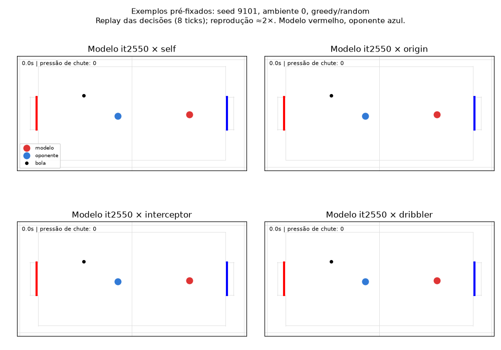

# Avaliação descritiva do comportamento — modelo it2550

O modelo analisado é o melhor pré-selecionado, it2550, não o endpoint3000.
O benchmark completo mostrou vantagem contra origem e heurísticas, mas não
identifica causalmente habilidades como antecipação ou drible planejado.

Foram examinados 72 registros pré-fixados: origem/best/endpoint × seis adversários
× dois modos × dois cenários, seed9101, ambiente0, lado vermelho. Uma única seed
com exemplos repetidos entre cenários/oponentes não representa uma nova amostra
estatística independente. As medidas geométricas são diagnósticos descritivos.

Nos seis exemplos greedy/random, a média por trajetória da pressão de chute caiu
16,36%→12,40% (origem→best); pressão distante da bola caiu14,13%→10,19% das
 decisões. Pressionar não significa que houve um chute efetivo. Há127/71 decisões
próximas da bola na origem/best nesses exemplos; esse conjunto é pequeno.

O alinhamento próximo da bola apresentou sinais de melhora nesses exemplos,
mas a distância média ao alvo atrás da bola não caiu:108,74→155,08 unidades.
As durações/resultados e ocupação de estados diferem. Não concluir que o bot
segue continuamente o alvo do potencial ou que o PBRS criou um controlador
ótimo de posicionamento. O gol permite afastamentos táticos e chutes rápidos.

O benchmark completo tem evidência mais forte: best contra origem em
randomgreedy score0,65381; randomsampled0,66895. Contra quatro estilos não
usados no currículo, score agregado0,937–0,961. Score=vitória+meioempate.
Resultados não certificam força contra pessoas nem causalidade de cada termo.

O self-play greedy/kickoff termina em empate em100% dos casos simétricos.
Best move a bola (stationary_fraction0,104); endpoint mantém bola parada1,0.
A condição de impasse depende da versão e do estado inicial. Em self-play
random/sampleado, empates caem59,38%→33,01% e duração24,03→16,46s.
Mais gols nessa condição não demonstra por si só coordenação, drible ou defesa.

Minha avaliação: o modelo é mais eficaz contra os adversários testados, usa
pressão de chute de forma parcialmente seletiva e resolve mais estados aleatórios.
Ainda apresenta impasses e falta evidência para atribuir planejamento de dribles,
interceptações ou defesa robusta. Jogos humanos continuam necessários.

A reprodução usa quatro exemplos pré-fixados greedy/random. Posições registradas
 a cada8ticks; aproximadamente2× velocidade. Os painéis congelam ao atingir o
último estado registrado antes da transição terminal; não simulam passos novos.

Métricas e definições em examples.json; fonte em ../behavior_review.py.
