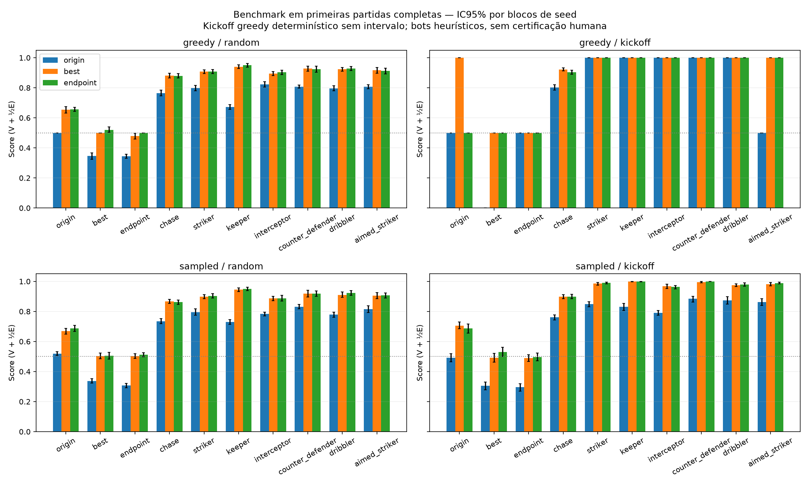
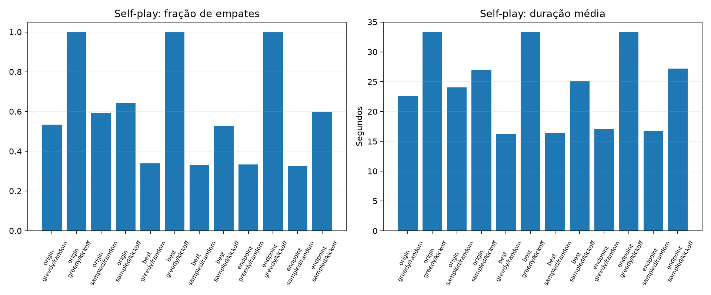

# Interpretação do benchmark final — 3000 iterações

3324 casos únicos e 106368 primeiras partidas completas, com mapas/pesos finitos e estados iniciais pareados por hash. Seeds inéditas 9101–9116; uma única seed de treinamento. As repetições determinísticas estão incluídas na contagem física, mas não são observações independentes nem recebem IC.

## Comparação por adversário

Os números abaixo são médias com pesos iguais dos quatro grupos modo×cenário; score = vitória + metade do empate. Não são taxas de vitória nem médias ponderadas pela contagem de episódios. As células e ICs estão em REPORT.md/summary.json.

| Adversário | Origem | Melhor (it2550) | Endpoint (it3000) |
|---|---:|---:|---:|
| origin | 0.5029 | 0.7572 | 0.6324 |
| best | 0.2471 | 0.4989 | 0.5140 |
| endpoint | 0.3617 | 0.4930 | 0.5023 |
| chase | 0.7657 | 0.8916 | 0.8864 |
| striker | 0.8606 | 0.9476 | 0.9504 |
| keeper | 0.8082 | 0.9712 | 0.9746 |
| interceptor | 0.8491 | 0.9371 | 0.9384 |
| counter_defender | 0.8810 | 0.9608 | 0.9608 |
| dribbler | 0.8621 | 0.9519 | 0.9578 |
| aimed_striker | 0.7463 | 0.9510 | 0.9523 |

## Evidência de avanço e limite da conclusão

O melhor pré-selecionado supera a origem no confronto direto: greedy/random 0,65381 (IC95% por seed 0,63281–0,67529); sampled/random 0,66895 (0,64941–0,68799); sampled/kickoff 0,70605 (0,68408–0,73047). Greedy/kickoff foi 1,0 em uma trajetória determinística repetida — não se atribui confiança estatística baseada nas 64 cópias.

Contra as sete heurísticas, best menos origem foi positivo em 23 das 28 células e empatou em cinco; 22 ICs pareados descritivos tiveram limite inferior positivo. Não houve célula com diferença negativa nesse conjunto. Interceptor, CounterDefender, Dribbler e AimedStriker não participaram do currículo. É evidência de generalização para esses scripts, não de força humana nem de aprendizagem de uma habilidade específica.

Os ICs são pontuais, por bootstrap de 16 blocos de seed, sem ajuste de multiplicidade. Os adversários compartilham estrutura e mapa; não são uma amostra de todos os jogadores. O preset reúne intervenções, portanto estes números não identificam causalmente PBRS, crítico ou currículo como causa isolada.

O endpoint não domina uniformemente o melhor. Nas 40 células contra adversários fixos, endpoint menos best teve 22 diferenças positivas, nove negativas e nove empates. A célula Chase/greedy/kickoff teve diferença −0,01855, IC95% −0,03467 a −0,00146. São resultados descritivos; não promover o endpoint retrospectivamente só porque ganha algumas células.

## Self-play: resultado e dinâmica

Todas as versões tiveram 100% de empates no kickoff greedy simétrico até 2000 ticks. O score 0,5 sozinho não mede força. No best, a bola ficou estacionária em 10,4% das decisões desse confronto; no endpoint, 100%. Portanto os empates têm dinâmicas diferentes, e o endpoint apresenta um impasse literal nessa condição específica.

Em estados random, o self-play do best teve 33,98% de empates greedy e 33,01% sampled, versus 53,32% e 59,38% na origem. Duração média caiu de 22,55/24,03 s para 16,21/16,46 s. Isso mostra mais partidas chegando a gol nessa distribuição; não demonstra automaticamente drible, antecipação ou melhor defesa.

Os gráficos de trajetória usam seis exemplos fixados antes da inspeção: seed9101, ambiente0, greedy/random, modelo vermelho. São exemplos, não evidência estatística nem seleção de jogadas bonitas. Linhas mostram posições a cada decisão, sem o estado terminal seguinte.

## Modelo para jogo humano e bloqueio de acesso

O candidato humano permanece models/sprint1_3000/model.pt, melhor it2550 escolhido antes desse benchmark. A exportação JS foi comparada com PyTorch em 256 observações dos dois lados: mesmas ações greedy, maior erro de logits 6,2967e−6, abaixo da tolerância 2e−5.

A tentativa real de sala carregou o mapa e fechou antes de fornecer link. Erro38 mapeado na dependência instalada para MissingRecaptchaCallbackError; o wrapper dessa dependência o rotula como token inválido. É necessário renovar o token ou atender o CAPTCHA, não um erro demonstrado do ator. Não se afirma que a sala esteja pronta. Token/arquivo .env e logs da sala não são publicados.

Atualize HEADLESS_TOKEN em headless-bot/.env com um token obtido em https://www.haxball.com/headlesstoken; depois, na raiz:

```bash
POLICY_PATH="$PWD/models/sprint1_3000/policy.json" node headless-bot/bot.js
```

A sala é privada, senha padrão bot; o link será emitido se a conexão for aceita. O computador deve continuar ligado. O treino está definitivamente encerrado em3000; nenhuma nova execução foi iniciada.





[Relatório completo por célula](REPORT.md).
