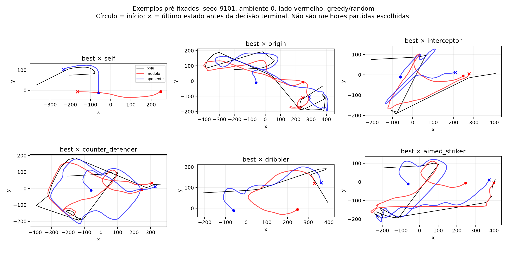

# Benchmark 3000 — partidas completas

Score = vitória + meio empate. Cada caso conta somente a primeira partida de cada ambiente;
gol encerra a partida, timeout em 2000 ticks (33,33 s) conta como empate. Isso não é uma partida multigol.
IC95% descritivo por bootstrap de blocos de seeds, não de episódios supostamente independentes.
Kickoff greedy determinístico repete trajetórias: não recebe intervalo nem alegação de precisão por repetição.
Bots táticos são heurísticas explícitas; não representam força humana certificada.

| Candidato | Adversário | Modo | Cenário | Score | IC95% por seed | V/E/D |
|---|---|---|---|---:|---|---|
| best | aimed_striker | greedy | kickoff | 1.0000 | determinístico | 64/0/0 |
| best | aimed_striker | greedy | random | 0.9170 | 0.897–0.935 | 932/14/78 |
| best | aimed_striker | sampled | kickoff | 0.9819 | 0.971–0.992 | 993/25/6 |
| best | aimed_striker | sampled | random | 0.9053 | 0.884–0.925 | 917/20/87 |
| best | best | greedy | kickoff | 0.5000 | determinístico | 0/64/0 |
| best | best | greedy | random | 0.5000 | 0.500–0.500 | 338/348/338 |
| best | best | sampled | kickoff | 0.4917 | 0.463–0.520 | 234/539/251 |
| best | best | sampled | random | 0.5039 | 0.485–0.524 | 347/338/339 |
| best | chase | greedy | kickoff | 0.9219 | 0.912–0.933 | 886/116/22 |
| best | chase | greedy | random | 0.8804 | 0.865–0.896 | 859/85/80 |
| best | chase | sampled | kickoff | 0.8979 | 0.885–0.911 | 855/129/40 |
| best | chase | sampled | random | 0.8662 | 0.854–0.880 | 829/116/79 |
| best | counter_defender | greedy | kickoff | 1.0000 | determinístico | 64/0/0 |
| best | counter_defender | greedy | random | 0.9282 | 0.910–0.945 | 948/5/71 |
| best | counter_defender | sampled | kickoff | 0.9956 | 0.991–0.999 | 1015/9/0 |
| best | counter_defender | sampled | random | 0.9194 | 0.897–0.942 | 936/11/77 |
| best | dribbler | greedy | kickoff | 1.0000 | determinístico | 64/0/0 |
| best | dribbler | greedy | random | 0.9229 | 0.910–0.936 | 936/18/70 |
| best | dribbler | sampled | kickoff | 0.9741 | 0.965–0.983 | 977/41/6 |
| best | dribbler | sampled | random | 0.9106 | 0.893–0.929 | 918/29/77 |
| best | endpoint | greedy | kickoff | 0.5000 | determinístico | 0/64/0 |
| best | endpoint | greedy | random | 0.4795 | 0.459–0.496 | 329/324/371 |
| best | endpoint | sampled | kickoff | 0.4897 | 0.468–0.511 | 191/621/212 |
| best | endpoint | sampled | random | 0.5029 | 0.486–0.519 | 334/362/328 |
| best | interceptor | greedy | kickoff | 1.0000 | determinístico | 64/0/0 |
| best | interceptor | greedy | random | 0.8945 | 0.882–0.909 | 878/76/70 |
| best | interceptor | sampled | kickoff | 0.9673 | 0.953–0.980 | 957/67/0 |
| best | interceptor | sampled | random | 0.8867 | 0.871–0.901 | 866/84/74 |
| best | keeper | greedy | kickoff | 1.0000 | determinístico | 64/0/0 |
| best | keeper | greedy | random | 0.9404 | 0.928–0.954 | 955/16/53 |
| best | keeper | sampled | kickoff | 0.9990 | 0.997–1.000 | 1022/2/0 |
| best | keeper | sampled | random | 0.9453 | 0.933–0.957 | 963/10/51 |
| best | origin | greedy | kickoff | 1.0000 | determinístico | 64/0/0 |
| best | origin | greedy | random | 0.6538 | 0.633–0.675 | 488/363/173 |
| best | origin | sampled | kickoff | 0.7061 | 0.684–0.730 | 497/452/75 |
| best | origin | sampled | random | 0.6689 | 0.649–0.688 | 510/350/164 |
| best | self | greedy | kickoff | 0.5000 | determinístico | 0/64/0 |
| best | self | greedy | random | 0.5000 | 0.500–0.500 | 338/348/338 |
| best | self | sampled | kickoff | 0.4917 | 0.464–0.520 | 234/539/251 |
| best | self | sampled | random | 0.5039 | 0.485–0.522 | 347/338/339 |
| best | striker | greedy | kickoff | 1.0000 | determinístico | 64/0/0 |
| best | striker | greedy | random | 0.9077 | 0.896–0.920 | 919/21/84 |
| best | striker | sampled | kickoff | 0.9854 | 0.976–0.993 | 998/22/4 |
| best | striker | sampled | random | 0.8975 | 0.884–0.912 | 908/22/94 |
| endpoint | aimed_striker | greedy | kickoff | 1.0000 | determinístico | 64/0/0 |
| endpoint | aimed_striker | greedy | random | 0.9131 | 0.893–0.932 | 925/20/79 |
| endpoint | aimed_striker | sampled | kickoff | 0.9893 | 0.983–0.995 | 1002/22/0 |
| endpoint | aimed_striker | sampled | random | 0.9067 | 0.889–0.922 | 916/25/83 |
| endpoint | best | greedy | kickoff | 0.5000 | determinístico | 0/64/0 |
| endpoint | best | greedy | random | 0.5205 | 0.503–0.541 | 371/324/329 |
| endpoint | best | sampled | kickoff | 0.5298 | 0.500–0.562 | 239/607/178 |
| endpoint | best | sampled | random | 0.5059 | 0.483–0.528 | 339/358/327 |
| endpoint | chase | greedy | kickoff | 0.9033 | 0.890–0.916 | 849/152/23 |
| endpoint | chase | greedy | random | 0.8799 | 0.865–0.894 | 849/104/71 |
| endpoint | chase | sampled | kickoff | 0.8994 | 0.886–0.914 | 857/128/39 |
| endpoint | chase | sampled | random | 0.8628 | 0.848–0.876 | 826/115/83 |
| endpoint | counter_defender | greedy | kickoff | 1.0000 | determinístico | 64/0/0 |
| endpoint | counter_defender | greedy | random | 0.9248 | 0.903–0.945 | 940/14/70 |
| endpoint | counter_defender | sampled | kickoff | 0.9995 | 0.999–1.000 | 1023/1/0 |
| endpoint | counter_defender | sampled | random | 0.9189 | 0.900–0.936 | 932/18/74 |
| endpoint | dribbler | greedy | kickoff | 1.0000 | determinístico | 64/0/0 |
| endpoint | dribbler | greedy | random | 0.9282 | 0.914–0.942 | 939/23/62 |
| endpoint | dribbler | sampled | kickoff | 0.9790 | 0.967–0.990 | 989/27/8 |
| endpoint | dribbler | sampled | random | 0.9238 | 0.907–0.938 | 934/24/66 |
| endpoint | endpoint | greedy | kickoff | 0.5000 | determinístico | 0/64/0 |
| endpoint | endpoint | greedy | random | 0.5000 | 0.500–0.500 | 341/342/341 |
| endpoint | endpoint | sampled | kickoff | 0.4966 | 0.472–0.522 | 202/613/209 |
| endpoint | endpoint | sampled | random | 0.5127 | 0.500–0.525 | 359/332/333 |
| endpoint | interceptor | greedy | kickoff | 1.0000 | determinístico | 64/0/0 |
| endpoint | interceptor | greedy | random | 0.9033 | 0.889–0.916 | 888/74/62 |
| endpoint | interceptor | sampled | kickoff | 0.9624 | 0.951–0.973 | 951/69/4 |
| endpoint | interceptor | sampled | random | 0.8877 | 0.869–0.907 | 866/86/72 |
| endpoint | keeper | greedy | kickoff | 1.0000 | determinístico | 64/0/0 |
| endpoint | keeper | greedy | random | 0.9497 | 0.937–0.961 | 971/3/50 |
| endpoint | keeper | sampled | kickoff | 0.9990 | 0.997–1.000 | 1022/2/0 |
| endpoint | keeper | sampled | random | 0.9497 | 0.938–0.960 | 970/5/49 |
| endpoint | origin | greedy | kickoff | 0.5000 | determinístico | 0/64/0 |
| endpoint | origin | greedy | random | 0.6558 | 0.643–0.669 | 485/373/166 |
| endpoint | origin | sampled | kickoff | 0.6875 | 0.656–0.717 | 471/466/87 |
| endpoint | origin | sampled | random | 0.6865 | 0.667–0.708 | 540/326/158 |
| endpoint | self | greedy | kickoff | 0.5000 | determinístico | 0/64/0 |
| endpoint | self | greedy | random | 0.5000 | 0.500–0.500 | 341/342/341 |
| endpoint | self | sampled | kickoff | 0.4966 | 0.473–0.522 | 202/613/209 |
| endpoint | self | sampled | random | 0.5127 | 0.500–0.525 | 359/332/333 |
| endpoint | striker | greedy | kickoff | 1.0000 | determinístico | 64/0/0 |
| endpoint | striker | greedy | random | 0.9087 | 0.895–0.922 | 924/13/87 |
| endpoint | striker | sampled | kickoff | 0.9897 | 0.984–0.995 | 1005/17/2 |
| endpoint | striker | sampled | random | 0.9033 | 0.890–0.917 | 912/26/86 |
| origin | aimed_striker | greedy | kickoff | 0.5000 | determinístico | 0/64/0 |
| origin | aimed_striker | greedy | random | 0.8076 | 0.794–0.821 | 726/202/96 |
| origin | aimed_striker | sampled | kickoff | 0.8618 | 0.839–0.884 | 781/203/40 |
| origin | aimed_striker | sampled | random | 0.8159 | 0.793–0.838 | 745/181/98 |
| origin | best | greedy | kickoff | 0.0000 | determinístico | 0/0/64 |
| origin | best | greedy | random | 0.3462 | 0.325–0.367 | 173/363/488 |
| origin | best | sampled | kickoff | 0.3047 | 0.279–0.331 | 70/484/470 |
| origin | best | sampled | random | 0.3374 | 0.324–0.352 | 167/357/500 |
| origin | chase | greedy | kickoff | 0.8032 | 0.785–0.820 | 647/351/26 |
| origin | chase | greedy | random | 0.7646 | 0.747–0.784 | 634/298/92 |
| origin | chase | sampled | kickoff | 0.7607 | 0.744–0.778 | 582/394/48 |
| origin | chase | sampled | random | 0.7344 | 0.718–0.751 | 583/338/103 |
| origin | counter_defender | greedy | kickoff | 1.0000 | determinístico | 64/0/0 |
| origin | counter_defender | greedy | random | 0.8081 | 0.797–0.819 | 711/233/80 |
| origin | counter_defender | sampled | kickoff | 0.8838 | 0.863–0.901 | 807/196/21 |
| origin | counter_defender | sampled | random | 0.8320 | 0.816–0.848 | 762/180/82 |
| origin | dribbler | greedy | kickoff | 1.0000 | determinístico | 64/0/0 |
| origin | dribbler | greedy | random | 0.7964 | 0.780–0.813 | 684/263/77 |
| origin | dribbler | sampled | kickoff | 0.8735 | 0.849–0.899 | 783/223/18 |
| origin | dribbler | sampled | random | 0.7783 | 0.762–0.795 | 662/270/92 |
| origin | endpoint | greedy | kickoff | 0.5000 | determinístico | 0/64/0 |
| origin | endpoint | greedy | random | 0.3442 | 0.331–0.357 | 166/373/485 |
| origin | endpoint | sampled | kickoff | 0.2954 | 0.270–0.320 | 78/449/497 |
| origin | endpoint | sampled | random | 0.3071 | 0.293–0.322 | 144/341/539 |
| origin | interceptor | greedy | kickoff | 1.0000 | determinístico | 64/0/0 |
| origin | interceptor | greedy | random | 0.8228 | 0.805–0.840 | 736/213/75 |
| origin | interceptor | sampled | kickoff | 0.7900 | 0.774–0.805 | 645/328/51 |
| origin | interceptor | sampled | random | 0.7837 | 0.771–0.796 | 672/261/91 |
| origin | keeper | greedy | kickoff | 1.0000 | determinístico | 64/0/0 |
| origin | keeper | greedy | random | 0.6724 | 0.657–0.689 | 416/545/63 |
| origin | keeper | sampled | kickoff | 0.8301 | 0.807–0.853 | 688/324/12 |
| origin | keeper | sampled | random | 0.7305 | 0.713–0.747 | 540/416/68 |
| origin | origin | greedy | kickoff | 0.5000 | determinístico | 0/64/0 |
| origin | origin | greedy | random | 0.5000 | 0.500–0.500 | 239/546/239 |
| origin | origin | sampled | kickoff | 0.4922 | 0.464–0.519 | 176/656/192 |
| origin | origin | sampled | random | 0.5195 | 0.508–0.533 | 228/608/188 |
| origin | self | greedy | kickoff | 0.5000 | determinístico | 0/64/0 |
| origin | self | greedy | random | 0.5000 | 0.500–0.500 | 239/546/239 |
| origin | self | sampled | kickoff | 0.4922 | 0.465–0.518 | 176/656/192 |
| origin | self | sampled | random | 0.5195 | 0.508–0.533 | 228/608/188 |
| origin | striker | greedy | kickoff | 1.0000 | determinístico | 64/0/0 |
| origin | striker | greedy | random | 0.7983 | 0.781–0.815 | 704/227/93 |
| origin | striker | sampled | kickoff | 0.8481 | 0.831–0.864 | 757/223/44 |
| origin | striker | sampled | random | 0.7959 | 0.775–0.818 | 711/208/105 |

Self-play simétrico não mede força absoluta. Um score próximo de 0,5 é esperado por troca de lados;
taxa de empates, duração e trajetórias ajudam a distinguir atividade de impasse.
Uma única seed de treinamento continua sendo a limitação deste estudo.

Diferenças pareadas e intervalos por seed estão em paired_deltas.json; estados iniciais foram conferidos por hash.
Os intervalos são pontuais e descritivos: não corrigem multiplicidade nem certificam generalização humana.

